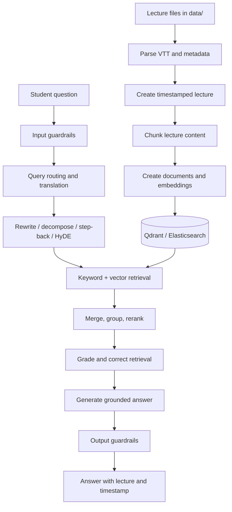

# Advance RAG Pattern Course Navigator

An experimental course assistant that turns lecture transcripts into searchable, timestamped answers. It uses Next.js, TypeScript, LangChain, Qdrant, and Elasticsearch while exploring query rewriting, decomposition, HyDE, hybrid search, reranking, and corrective retrieval.

## How it works



The `data/` directory contains local input and is ignored by Git. Add transcript files there before indexing a course.

## Prerequisites

- Node.js 20 or newer
- pnpm 11
- An OpenAI API key
- Qdrant for vector search
- Elasticsearch for hybrid or keyword search
- Redis if you use the queue components

Create `.env.local` with the services you use:

```env
OPENAI_API_KEY=your_openai_key
QDRANT_URL=http://localhost:6333
QDRANT_API_KEY=your_qdrant_key
ELASTICSEARCH_URL=http://localhost:9200
ELASTICSEARCH_API_KEY=your_elasticsearch_key
REDIS_URL=redis://localhost:6379
```

## Run locally

```bash
pnpm install
pnpm dev
```

Open [http://localhost:3000](http://localhost:3000). The web page is currently a small shell; the course-navigation pipeline lives in `src/rag` and `scripts`.

## Index a course

Place lecture data under `data/`, then run the indexer for your backend:

```bash
pnpm index:elastic
```

The ingestion pipeline parses lecture files, preserves timestamps, chunks the content, and prepares documents for retrieval. Qdrant indexing is available through `src/rag/indexing`.

## Useful checks

```bash
pnpm lint
pnpm test:parser
pnpm test:lectures
pnpm test:chunks
pnpm test:search
pnpm test:rag
pnpm test:hybrid
pnpm test:rewrite
```

## Project map

| Path | Purpose |
| --- | --- |
| `src/rag/ingestion` | Parse transcripts and lecture metadata |
| `src/rag/chunking` | Split lectures into retrieval chunks |
| `src/rag/query-translation` | Rewrite, decompose, step back, and generate HyDE queries |
| `src/rag/retrieval` | Vector, keyword, hybrid, and grouped search |
| `src/rag/reranking` | Improve retrieved-result ordering |
| `src/rag/crag` | Grade and correct retrieved context |
| `src/rag/generation` | Generate answers with lecture timestamps |
| `scripts/tests` | Executable checks for individual components |
| `notes` | Design notes and RAG experiments |

## Status

This is a learning and experimentation project. Individual scripts may require local backing services and configuration for your course data.
